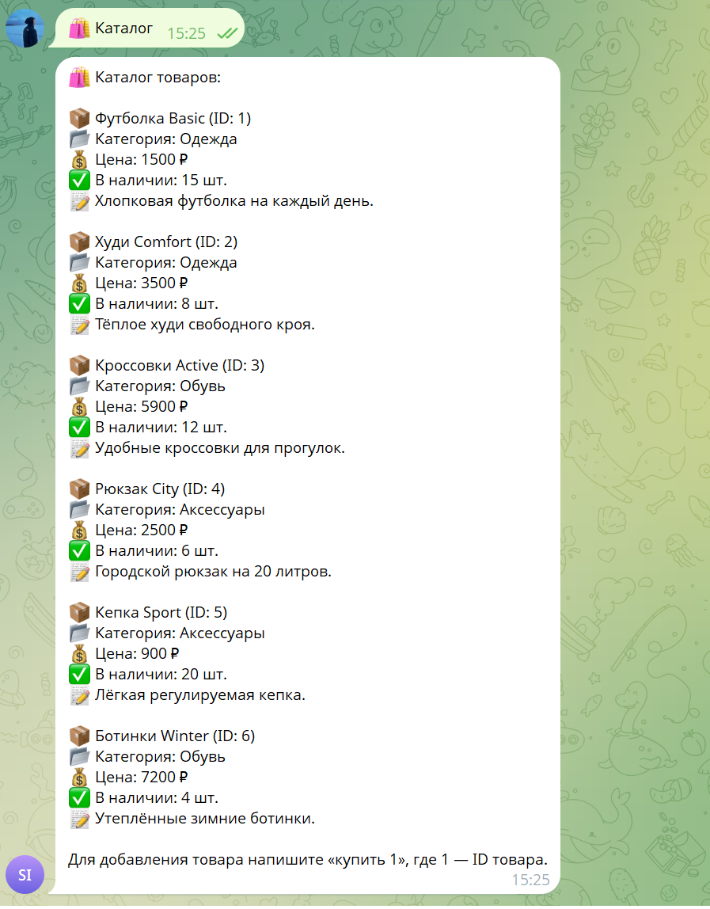
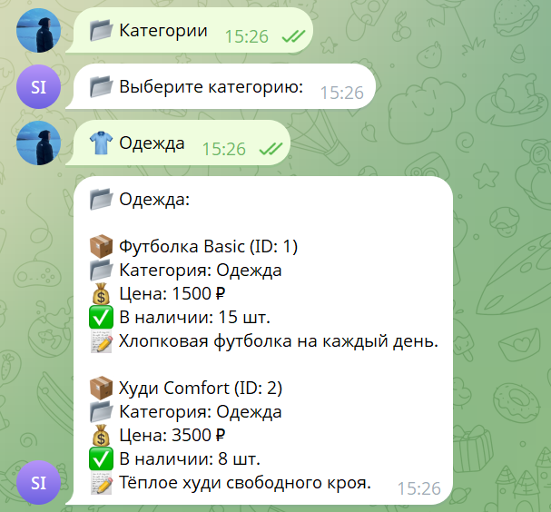
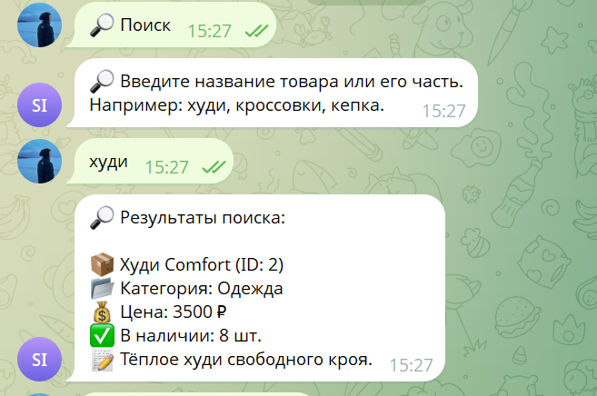
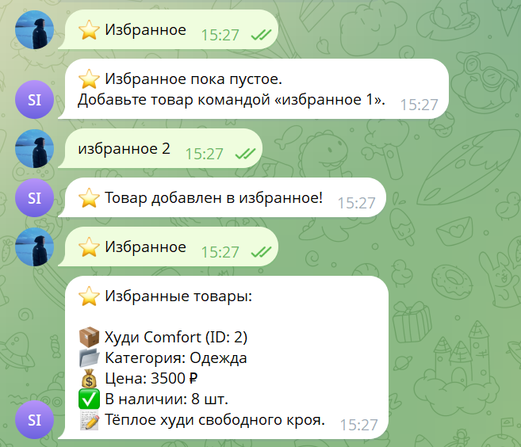
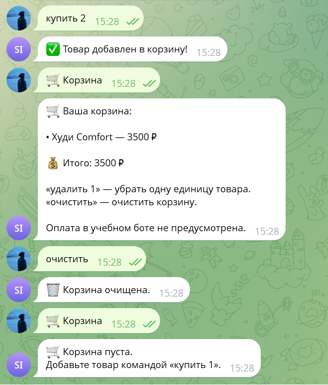

# Отчёт по лабораторной работе №1

## Разработка MVP Telegram-бота

**Студент:** Куприянова Арина Владимировна  
**Группа:** U4225  
**Дисциплина:** Vibe Coding for Business  
**Проект:** SmartShop Assistant  
**Год:** 2026

## 1. Цель работы

Разработать минимально жизнеспособный продукт (MVP)
в формате Telegram-бота, предназначенного для
автоматизации взаимодействия покупателей
с небольшим розничным магазином.

## 2. Описание бизнес-проблемы

Небольшие магазины часто используют мессенджеры
для общения с покупателями. Сотрудникам приходится
вручную отвечать на повторяющиеся вопросы
об ассортименте, стоимости и наличии товаров.

SmartShop Assistant демонстрирует возможность
автоматизации этих операций с помощью Telegram-бота.

## 3. Целевая аудитория

- Покупатели небольших розничных магазинов.
- Сотрудники магазинов, обрабатывающие обращения.
- Владельцы бизнеса, заинтересованные в автоматизации.

## 4. Функциональные возможности MVP

В реализованной версии предусмотрены:

1. Приветствие и главное меню.
2. Просмотр каталога товаров.
3. Фильтрация товаров по категориям.
4. Поиск по названию и описанию.
5. Добавление и удаление товаров из избранного.
6. Добавление и удаление товаров из корзины.
7. Автоматический расчёт стоимости корзины.
8. Просмотр информации о проекте и справки.

## 5. Используемые технологии

- Python 3.14.
- python-telegram-bot 22.8.
- python-dotenv.
- Telegram Bot API.
- Cursor.
- Git и GitHub.

### 5.1. Использование искусственного интеллекта

В процессе разработки использовался ChatGPT
для проектирования MVP, создания Python-кода,
анализа ошибок и подготовки тестовых сценариев.

Разработка осуществлялась итерационно:
постановка задачи, получение решения,
внедрение кода, тестирование и исправление ошибок.

Подробная история этапов работы с ИИ приведена
в документе [PROMPTS.md](PROMPTS.md).

## 6. Архитектура приложения

Приложение реализовано на Python с использованием
асинхронных обработчиков Telegram-сообщений.

Каталог содержит шесть демонстрационных товаров,
хранящихся в словаре Python.

Данные корзины и избранного временно хранятся
в памяти приложения отдельно для каждого пользователя.

Бот получает сообщения через long polling.

## 7. Результаты тестирования

Проведена ручная проверка следующих сценариев:

| Сценарий | Результат |
|---|---|
| Запуск бота | Успешно |
| Открытие каталога | Успешно |
| Фильтрация по категориям | Успешно |
| Поиск товара | Успешно |
| Добавление в избранное | Успешно |
| Добавление в корзину | Успешно |
| Расчёт суммы корзины | Успешно |
| Очистка корзины | Успешно |

### 7.1. Скриншоты работы Telegram-бота

Ниже представлены результаты функционального тестирования
SmartShop Assistant 2.0 в Telegram.

**Рисунок 1 — Каталог товаров**

**Рисунок 2 — Фильтрация по категориям**

**Рисунок 3 — Поиск товаров**

**Рисунок 4 — Работа с избранным**

**Рисунок 5 — Корзина и расчёт стоимости**

### 7.2. Результаты проверки

По результатам ручного тестирования подтверждена
работоспособность основных функций MVP.

Пользователь может просматривать каталог, выполнять
поиск, выбирать категории, добавлять товары
в избранное и корзину, а также очищать корзину.

Критических ошибок в проверенных сценариях
не обнаружено.

## 8. Ограничения MVP

- Данные корзины и избранного теряются после перезапуска.
- Каталог содержит демонстрационные товары.
- База данных пока не подключена.
- Реальная оплата не предусмотрена.
- Оформление заявок будет добавлено позднее.

## 9. План развития

В лабораторной работе №2 планируется подключение
SQLite для постоянного хранения данных.

В лабораторной работе №3 планируется облачное
развёртывание, пользовательское тестирование,
сбор обратной связи и улучшение приложения.

## 10. Ссылки

**Telegram-бот:** https://t.me/itmoftmi_kav_bot

**GitHub:** https://github.com/ar2801k/2026-chatbots-u4225-kupriyanova_a_v

## 11. Вывод

Разработан работоспособный MVP Telegram-бота
SmartShop Assistant.

Реализованы основные сценарии взаимодействия
покупателя с каталогом товаров. Проведённые
функциональные проверки подтвердили работоспособность
ключевых возможностей.

Проект подготовлен к следующему этапу —
подключению постоянного источника данных.
  