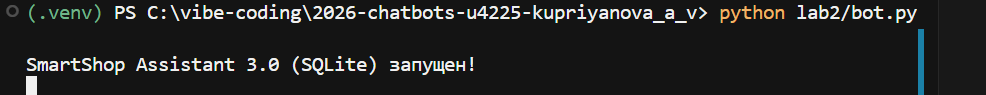
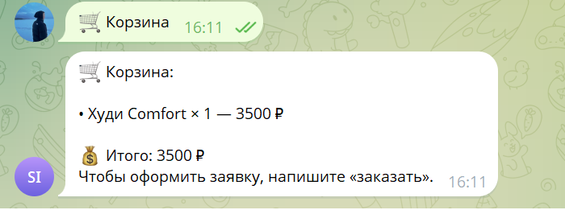
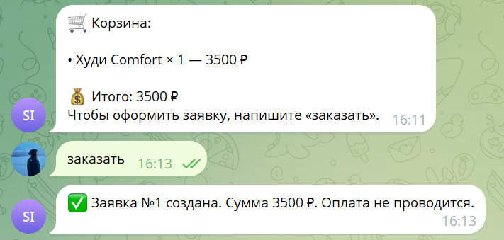
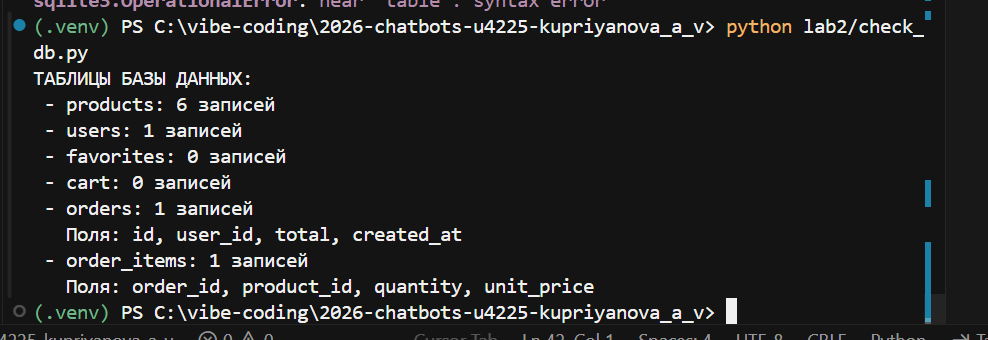
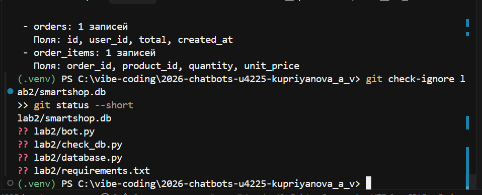

University: [ITMO University](https://itmo.ru/ru/)
Faculty: [FICT](https://fict.itmo.ru)
Course: [Vibe Coding: AI-???? ??? ???????](https://github.com/ex-itmo-ict-faculty/vibe-coding-for-business)
Year: 2026/2027
Group: U4225
Author: Kupriyanova Arina Vladimirovna
Lab: Lab2
Date of create: 16.10.2026
Date of finished: ?? ????????

---

# Отчёт по лабораторной работе №2

## Подключение источника данных к Telegram-боту

**Студент:** Куприянова Арина Владимировна  
**Группа:** U4225  
**Дисциплина:** Vibe Coding for Business  
**Вуз:** Университет ИТМО  
**Проект:** SmartShop Assistant 3.0  
**Год:** 2026

## 1. Цель работы

Подключить к Telegram-боту постоянный источник данных SQLite и реализовать операции чтения и записи для каталога, пользовательского избранного, корзины и заявок.

## 2. Бизнес-контекст

Покупателям малого магазина необходимо получать сведения о товарах, сохранять выбранные позиции и формировать заявку без участия сотрудника на каждом этапе. В ЛР №1 данные были демонстрационными и частично хранились только в памяти процесса. ЛР №2 устраняет эту техническую ограниченность за счёт SQLite.

## 3. Используемые технологии

Python 3.14.3, встроенный модуль `sqlite3`, `python-telegram-bot` 22.8, `python-dotenv`, Telegram Bot API, Git, GitHub, Cursor. ChatGPT использовался для подготовки кода и диагностики.

## 4. Архитектура

```text
Пользователь Telegram
        |
        v
Telegram Bot API (long polling)
        |
        v
lab2/bot.py (команды, кнопки, сообщения)
        |
        v
lab2/database.py (SQL-запросы и транзакции)
        |
        v
lab2/smartshop.db (SQLite, локальный файл)
```

В `bot.py` пользователь определяется по Telegram ID. `database.py` открывает подключения с `PRAGMA foreign_keys=ON`, создаёт таблицы, параметризует значения в SQL-запросах и фиксирует операции записи через контекстный менеджер подключения.

## 5. Схема базы данных

| Таблица | Ключевые поля | Назначение |
|---|---|---|
| `products` | `id`, `name`, `category`, `price`, `stock`, `description` | Каталог и остатки |
| `users` | `telegram_id`, `first_name` | Пользователи |
| `favorites` | `user_id`, `product_id` | Избранное |
| `cart` | `user_id`, `product_id`, `quantity` | Корзина по пользователям |
| `orders` | `id`, `user_id`, `total`, `created_at` | Заявки |
| `order_items` | `order_id`, `product_id`, `quantity`, `unit_price` | Строки заявки |

Между таблицами настроены внешние ключи. Для `cart` и `favorites` используется составной первичный ключ. При создании заявки фиксируются строки заказа, уменьшается остаток товаров и очищается корзина в рамках одной операции с базой.

## 6. Реализованные функции

- Первоначальное заполнение каталога шестью учебными товарами.
- Чтение каталога из SQLite, фильтрация по категории и поиск по названию/описанию.
- Добавление/удаление избранных товаров.
- Добавление/удаление товара в корзине с учётом остатка и количества.
- Расчёт суммы заказа.
- Создание учебной заявки без платежей.
- Просмотр истории заявок.

## 7. Функциональное тестирование

| Сценарий | Наблюдаемый результат | Статус |
|---|---|---|
| Первый запуск | В терминале сообщение `SmartShop Assistant 3.0 (SQLite) запущен!`; создан файл базы | Пройден |
| Сохранение корзины | После перезапуска отображается `Худи Comfort × 1 — 3500 ₽` | Пройден по сообщению пользователя и скриншоту |
| Оформление заявки | Telegram сообщил: `Заявка №1 создана. Сумма 3500 ₽` | Пройден |
| Проверка SQLite | `products=6`, `users=1`, `orders=1`, `order_items=1`; после оформления `cart=0` | Пройден |
| Исключение базы из Git | `git check-ignore` вернул `lab2/smartshop.db` | Пройден |

Проверка сохранения избранного после перезапуска и дополнительные негативные сценарии (отсутствующий ID, нехватка остатка) отдельно не зафиксированы и могут быть дополнительно протестированы перед защитой.

### 7.1. Подтверждающие изображения

**Рисунок 1 — Запуск бота с SQLite**



**Рисунок 2 — Корзина после перезапуска**



**Рисунок 3 — Подтверждение создания заявки**



**Рисунок 4 — Таблицы базы и число записей**



**Рисунок 5 — Игнорирование SQLite-файла в Git**



## 8. Проблема и решение

При попытке проверки таблиц SQLite через однострочную команду `python -c` в PowerShell возникла ошибка SQL-синтаксиса из-за обработки кавычек. Для более надёжной диагностики создан отдельный `check_db.py`, который корректно вывел таблицы и количество записей.

## 9. Безопасность и ограничения

- Секретный токен хранится в локальном `.env` и не должен попадать в репозиторий.
- Файл `smartshop.db` игнорируется Git (проверено).
- SQLite — локальное файловое хранилище: при запуске на другом устройстве создаётся новая база; данные автоматически не синхронизируются.
- В учебной версии нет реальной оплаты и интеграции с действующей товароучётной системой.
- Для облачного запуска понадобится обеспечить постоянное хранение данных.

## 10. Применение ИИ

Для генерации и обновления кода, диагностики подключения и подготовки проверок использовался ChatGPT. Описание фактических этапов и реконструированные формулировки задач приведены в [PROMPTS.md](PROMPTS.md). Реконструированные формулировки не выдаются за дословную переписку.

## 11. Исходные материалы

- [Telegram-бот](https://t.me/itmoftmi_kav_bot)
- [Репозиторий GitHub](https://github.com/ar2801k/2026-chatbots-u4225-kupriyanova_a_v)
- [Код Telegram-бота](bot.py)
- [Модуль SQLite](database.py)
- [Проверочный скрипт](check_db.py)

## 12. Вывод

Реализована версия Telegram-бота SmartShop Assistant 3.0 с SQLite. Подтверждены запуск программы, сохранение корзины после перезапуска, создание заявки и наличие соответствующих записей в таблицах базы. Решение расширяет MVP лабораторной №1 и создаёт техническую основу для последующего развёртывания и тестирования с пользователями.
