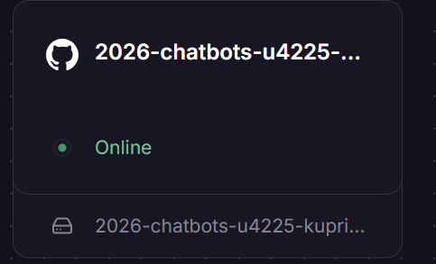
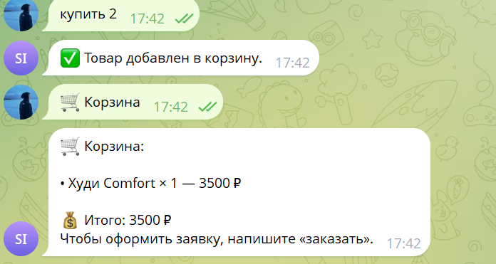

# Отчёт по лабораторной работе №3

**Студент:** Куприянова Арина Владимировна  
**Группа:** U4225  
**Дисциплина:** Vibe Coding for Business  
**Тема:** Развёртывание SmartShop Assistant в облаке, тестирование и сбор обратной связи

## 1. Цель

Развернуть Telegram-бота в облачной инфраструктуре, проверить доступность вне локального компьютера, организовать пользовательское тестирование и доработать продукт на основании реальных отзывов.

## 2. Исходный продукт

SmartShop Assistant — учебный Telegram-бот магазина с каталогом, поиском, категориями, корзиной и оформлением заявки. В ЛР №2 используется SQLite.

## 3. Облачная инфраструктура

- Платформа: Railway.
- Подключение исходного кода: GitHub, репозиторий `ar2801k/2026-chatbots-u4225-kupriyanova_a_v`.
- Root Directory: `/lab3`.
- Start Command: `python bot.py`.
- Переменные окружения: `BOT_TOKEN`, `DATABASE_PATH` (секретное значение не раскрывается).
- Постоянный том: mount path `/data`.
- Предполагаемый путь БД: `/data/smartshop.db`.

## 4. Реализованный результат и подтверждения

Сервис Railway показал состояние **Online**. Telegram-бот ответил на сообщение о добавлении товара в корзину и вывел корзину с одним товаром «Худи Comfort» на сумму 3500 ₽. По сообщению тестирующего, бот продолжил отвечать после закрытия Cursor.

**Рисунок 1 — Railway: состояние Online**

**Рисунок 2 — Ответ облачного бота и корзина**

Отдельная проверка сохранения данных после **Restart сервиса Railway** ещё должна быть подтверждена и задокументирована; состояние Online само по себе этого не доказывает.

## 5. Методика пользовательского тестирования

Сценарии, приглашение и критерии фиксации результатов: [TESTING.md](TESTING.md).

Тестирование проводят реальные пользователи, не подменяя их ответы модельными. Не собираются номера телефонов, реальные имена и иные лишние персональные сведения.

## 6. Результаты пользовательского тестирования

**Количество реальных участников:** 3  
**Дата:** 16 октября 2026 года (по ходу проекта)

| Участник | Успешность | Оценка удобства | Замечание / предложение |
|---|---|---:|---|
| T01 | Все действия выполнены | 4/5 | Добавление в корзину было неочевидно: пришлось открыть помощь. Нужны понятные указания или кнопка. |
| T02 | Всё понятно | 5/5 | Хотелось бы видеть фотографии товаров. |
| T03 | Все действия выполнены | 5/5 | Интерфейс понятный, дополнительных предложений нет. |

**Средняя оценка:** (4 + 5 + 5) / 3 = **4,67 из 5**. Данные получены из ответов реальных тестировщиков, переданных в переписке.

## 7. Доработка по результатам обратной связи

Приоритетная проблема — неочевидный способ добавления товара. Подготовлена версия `bot.py` с inline-кнопками **«🛒 В корзину»** и **«⭐ Избранное»** под каждой карточкой в каталоге, категориях и результатах поиска. При нажатии используется существующая логика SQLite; ограничение наличия товара сохраняется.

**Состояние:** код доработки подготовлен. Повторное тестирование на Railway и публикация коммита должны быть выполнены, прежде чем отмечать улучшение как внедрённое.

Пожелание об изображениях включено в план дальнейшего развития, пока не реализовано.

## 8. Вывод

Бот развёрнут в Railway, показал статус Online и отвечал вне Cursor. Собрана обратная связь трёх пользователей с оценками 4, 5 и 5. На её основе подготовлено адресное улучшение интерфейса. Для закрытия работы требуется проверить новые кнопки после облачного деплоя и зафиксировать результат, а также подтвердить сохранность SQLite после отдельного перезапуска Railway, если это ещё не сделано.

## 9. Ссылки

- Telegram: https://t.me/itmoftmi_kav_bot
- GitHub: https://github.com/ar2801k/2026-chatbots-u4225-kupriyanova_a_v
